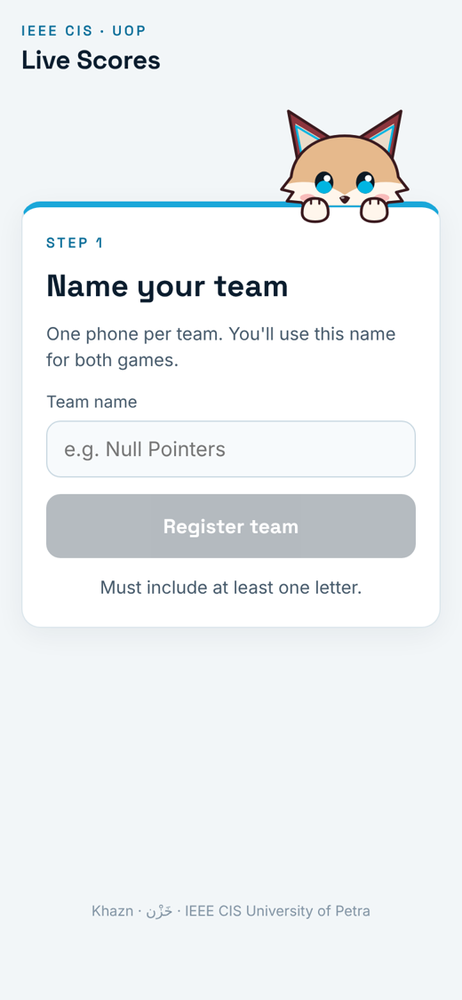
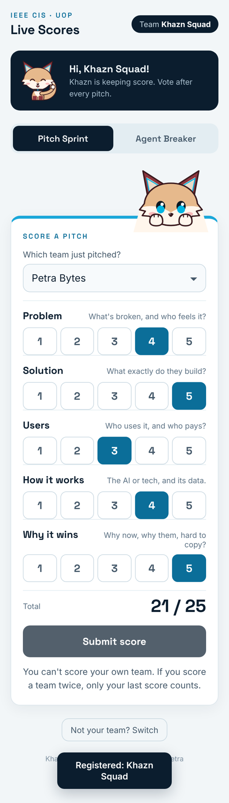
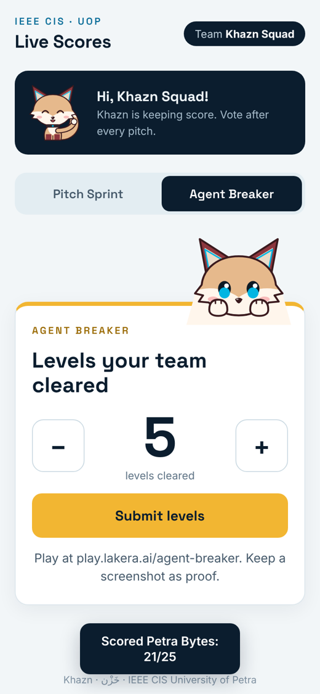
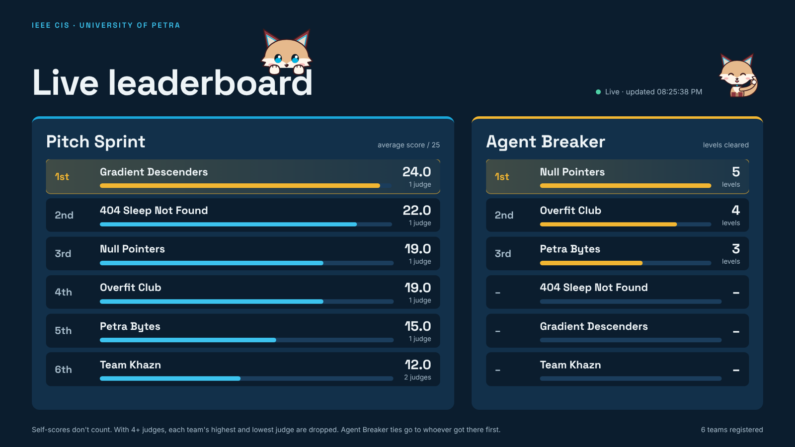

# IEEE CIS UOP · Live Scores

The voting site and live leaderboard used at the **IEEE CIS University of Petra introductory session** on 25 November 2026. It ran two team games:

- **Pitch Sprint:** each team built an AI startup idea and pitched it in one minute. The other teams scored every pitch from 1 to 5 on five criteria: Problem, Solution, Users, How it works and Why it wins.
- **Agent Breaker:** teams played the prompt-injection game at [play.lakera.ai/agent-breaker](https://play.lakera.ai/agent-breaker) and submitted how many levels they cleared.

Teams used one phone each to vote, and the leaderboard updated live on the projector. The site is no longer hosted. This repo keeps the code and screenshots.

## Screenshots

These were taken in demo mode, with made-up teams.

| Register a team | Score a pitch | Agent Breaker |
|---|---|---|
|  |  |  |

**Projector leaderboard**

## How it worked

- The whole site is one file, `index.html`, with no build step. It was hosted free on GitHub Pages.
- **Storage:** a Google Form. Phones post answers to the form's `formResponse` endpoint, and the form writes them to a Google Sheet.
- **Reading scores:** the leaderboard reads that sheet through the Google Visualization API (JSONP) and refreshes every 4 seconds.
- **Rules applied in the code:**
  - A team can't score its own pitch.
  - If a team scores another team twice, only its latest score counts.
  - Once 4 or more teams have scored a team, its highest and lowest scores are dropped.
  - For Agent Breaker, each team's best submission counts, and ties go to whoever submitted first.
- Each phone gets a random team code when it registers, so other phones can't submit in that team's name.
- Khazn, the chapter mascot, is drawn inline as SVG.

## Running it again

- Add `?demo` to the address to preview with fake data, or `?demo#board` for the leaderboard. No setup is needed.
- `#board` opens the projector view, and `#setup` shows the steps for connecting a new Google Form and Sheet. Afterwards, paste the form's pre-filled link and the sheet's URL into `CONFIG` at the top of the script.
- To host it again, turn GitHub Pages back on under **Settings → Pages**, deploying from the `main` branch, root folder.
